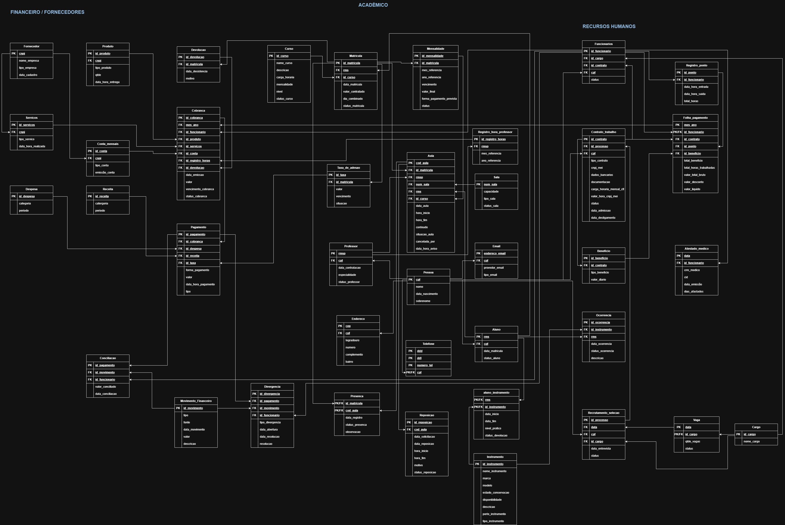

# 🎵 Murbach Music School — Banco de Dados

## 📌 Sobre o projeto

O projeto **Murbach Music School** consiste no desenvolvimento de um banco de dados para representar e organizar os processos de uma escola de música fictícia.

A proposta é estruturar as informações da instituição em um modelo integrado, contemplando diferentes setores e suas necessidades, desde o gerenciamento acadêmico até o controle financeiro e administrativo.

O desenvolvimento envolve a modelagem do banco, definição das tabelas e relacionamentos, criação de comandos SQL, inserção de dados e elaboração de consultas e testes de integridade.

## 🎯 Objetivos

- Organizar as informações dos diferentes setores da escola.
- Desenvolver o Diagrama Entidade-Relacionamento (DER).
- Converter a modelagem conceitual em modelo lógico.
- Definir chaves primárias, estrangeiras e restrições.
- Estruturar o banco de dados utilizando SQL.
- Elaborar consultas para obtenção de informações gerenciais.
- Criar testes para verificar as regras de integridade dos dados.

## 🏫 Setores contemplados

O banco de dados foi estruturado para atender quatro áreas principais:

| Setor | Funcionalidades representadas |
|---|---|
| 🎓 Acadêmico | Alunos, matrículas, cursos, aulas, presenças e reposições. |
| 👨‍🏫 Professores | Cadastro de professores, registros de horas e informações relacionadas às aulas. |
| 💰 Financeiro | Fornecedores, cobranças, mensalidades, pagamentos, receitas, despesas e conciliação financeira. |
| 👥 Recursos Humanos | Funcionários, cargos, vagas, contratos, benefícios, folha de pagamento e registro de ponto. |

## 🗂️ Modelagem do banco de dados

### Diagrama Entidade-Relacionamento (DER)

O DER apresenta a modelagem conceitual do sistema, demonstrando as entidades e os relacionamentos identificados durante o levantamento dos requisitos.

### Modelo lógico

O modelo lógico apresenta a estrutura relacional do banco, com suas tabelas, atributos, chaves primárias e estrangeiras.

## 💻 Scripts SQL

O repositório contém arquivos SQL separados de acordo com suas finalidades:

| Arquivo | Finalidade |
|---|---|
| `banco_grupo01.sql` | Criação do banco de dados e das tabelas, com seus relacionamentos e restrições. |
| `insercao_grupo01.sql` | Inserção de registros para compor a massa de dados utilizada no projeto. |
| `consultas_grupo01.sql` | Consultas para obtenção e análise de informações acadêmicas, financeiras e administrativas. |
| `testes_grupo01.sql` | Comandos destinados a verificar a aplicação das restrições e regras de integridade. |

### Principais recursos utilizados

- `PRIMARY KEY` e `FOREIGN KEY`.
- Restrições `NOT NULL` e `UNIQUE`.
- Restrições `CHECK`.
- Relacionamentos entre tabelas.
- Consultas com `SELECT`, `JOIN`, filtros e ordenações.
- Inserção de dados com `INSERT`.
- Atualizações e exclusões utilizadas nos testes de integridade.

## 🔎 Consultas e testes

As consultas SQL foram organizadas para responder a situações práticas da escola, incluindo acompanhamento de cobranças, pagamentos, despesas, folha de pagamento e movimentações financeiras.

O arquivo de testes reúne situações que devem ser rejeitadas pelo banco, como duplicidade de chaves, referências inexistentes, valores fora dos limites definidos e violações das regras entre colunas.

**Observação:** os arquivos documentam os comandos e cenários preparados para o projeto. A confirmação de execução e dos resultados dos testes depende da realização dos procedimentos no SGBD.

## 👨‍💻 Integrantes

- Antonia Taiani da Silva
- Evandro Evair Condori Colque
- Fabricio de Oliveira
- Gustavo Augusto Barbara
- Gustavo Cesar do Nascimento Romão
- João Vitor Ferreira Ramos
- Kaua Henrique Nascimento Cavalcante
- Mariana Cerqueira Antonini
- Thiago Roberto de Oliveira

## 🎓 Contexto acadêmico

Projeto desenvolvido como atividade acadêmica na área de Banco de Dados.

---

  <strong>Murbach Music School</strong> 
  Modelagem, estruturação e documentação de banco de dados.

